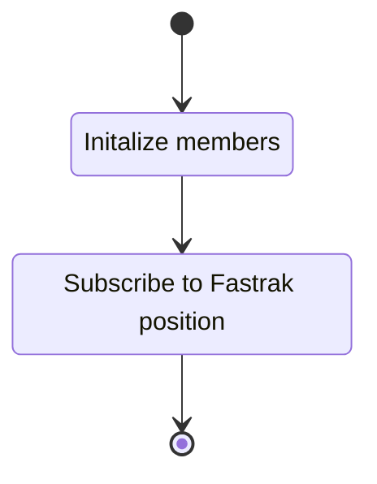
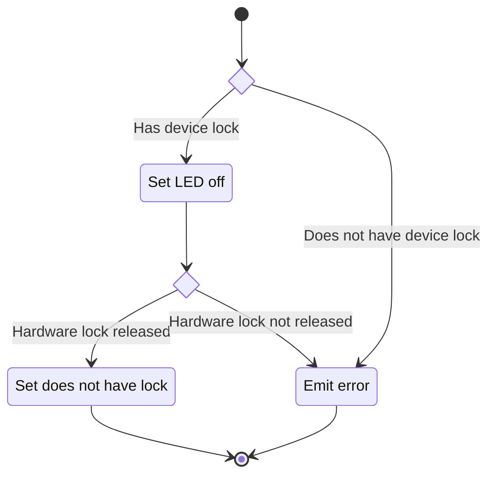
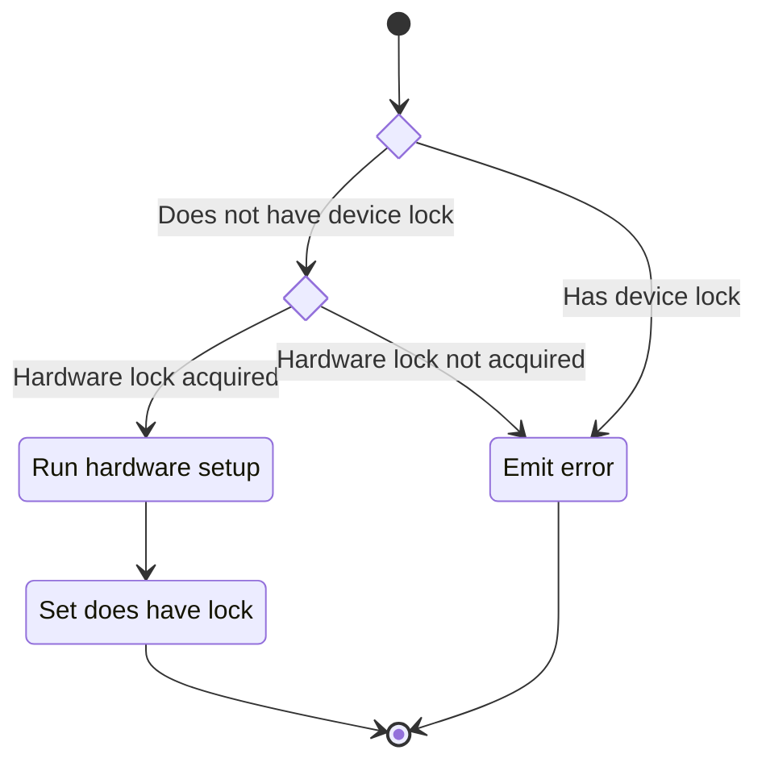
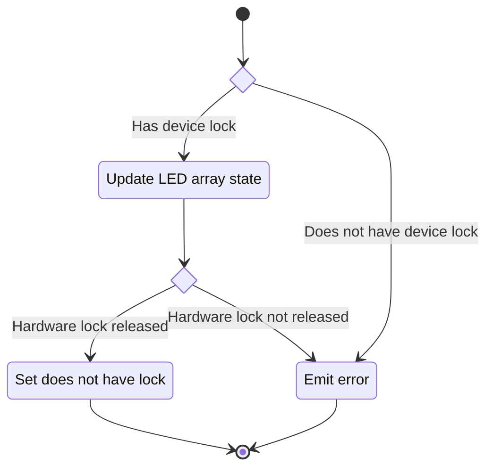

## Description

This unit describes the functionality of the LED array component hardware wrapper. The class offers
a simple interface for the LED array hardware device to be used in an experiment.

### Members

#### Public Data

##### Status

The `status` is an expected interface for all components in an experiment. The status is essentially
an enum of possible states a component can be in. The status is essentially an enum of possible
states a component can be in. Unfortunately, PsychoPy doesn't use an actual enum for this purpose
but instead a [SimpleNamespace](https://docs.python.org/3/library/types.html#types.SimpleNamespace).

#### Private Data

- LED Device: A reference to the hardware device that is being wrapped.
- Fastrak Device: A reference to the Fastrak hardware device supplying the position data.
- Listener: The callback object that subscribes to the Fastrak position.  
- Device Lock Status: Indicates if the wrapper has the lock on the linked LED Device

### Interfaces

#### Constructor

The constructor method takes in a collection of data:

- LED Device: The hardware device to wrap.
- Fastrak Device: A reference to the Fastrak hardware device supplying the position data.

##### State Machine

#### Reset

Since wrapper instances are reused between routine instances to simplify how this works we reset the
state of the wrapper instead of recreate the wrapper.

##### State Machine

#### Startup

The `startup` method sets the state of the wrapped hardware device to the correct settings.
Additionally, acquires a lock on the wrapped device.

##### State Machine

#### Step

The `step` method updates the state of the wrapper based on position every step of the experiment.

>[!note]
>
> An improvement here would be to do this in a thread and not in the same thread as the experiment.

##### State Machine

